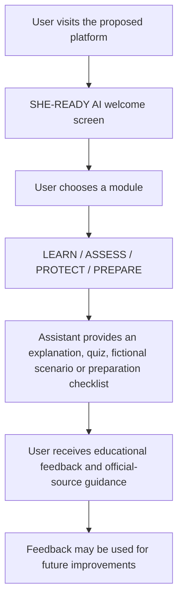
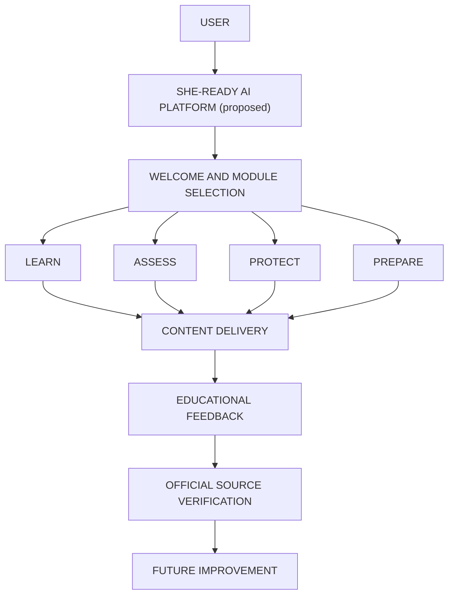
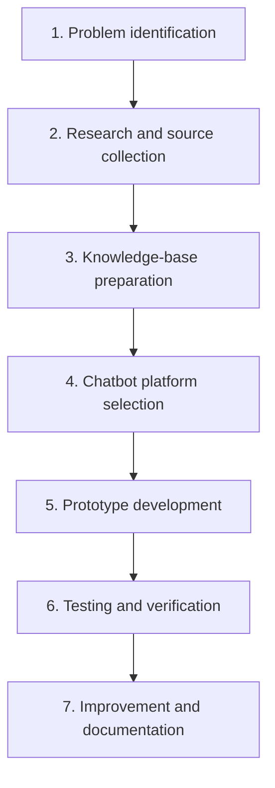
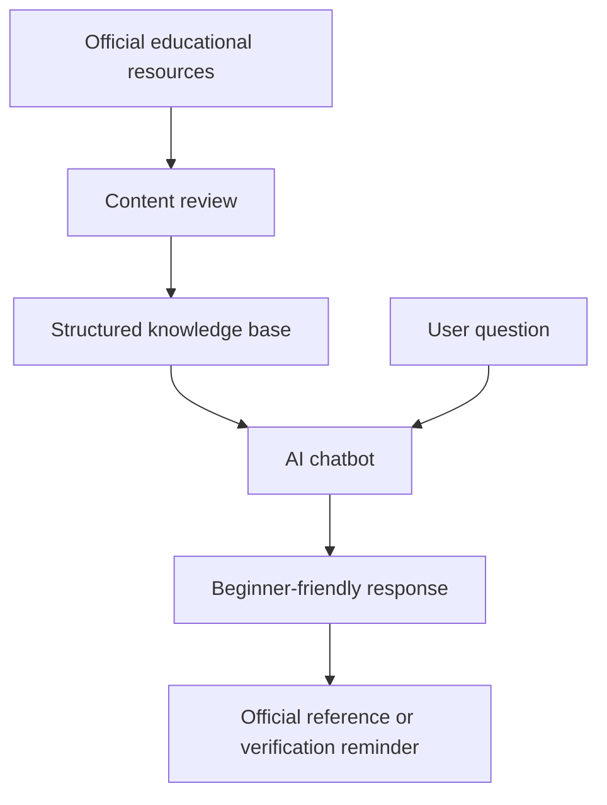

# SHE-READY AI: Project Workflow Document

**AI Financial Readiness and Empowerment Assistant for Women in India**

| | |
|---|---|
| **Document type** | Proposed system design and workflow document |
| **Project type** | Student AI project (AICW fellowship) |
| **Document status** | Draft for review |
| **Last updated** | 23 November 2026 |

> **Important notice:** SHE-READY AI is a **proposed** project. The chatbot and the website have **not yet been built**. All diagrams, workflows and component descriptions in this document are **proposed designs**, not descriptions of a working system. No screenshots, test results or user evidence are included, because none exist yet.

---

## Table of Contents

1. [Project Overview](#section-1--project-overview)
2. [Problem Identification](#section-2--problem-identification)
3. [Complete User Journey](#section-3--complete-user-journey)
4. [Four Module Explanations](#section-4--four-module-explanations)
5. [System Workflow Diagrams](#section-5--system-workflow-diagrams)
6. [Technology and System Components](#section-6--technology-and-system-components)
7. [Data Flow](#section-7--data-flow)
8. [Privacy and Responsible AI](#section-8--privacy-and-responsible-ai)
9. [Current Project Development Status](#section-9--current-project-development-status)
10. [Future Development Plan](#section-10--future-development-plan)

---

## Section 1 – Project Overview

### What is SHE-READY AI?

SHE-READY AI is a **proposed** AI-assisted financial education and awareness platform for women in India. It is designed to make basic financial concepts, banking services, digital payments and financial safety information easier to understand.

The platform is planned as a guided educational assistant. It would explain topics in simple language, offer practice quizzes, show fictional scam examples and provide checklists to help users prepare before visiting a bank.

### Why is it being developed?

Banking and digital payment services are now part of everyday life, but many first-time users find the terms, steps and risks confusing. A simple, patient and beginner-friendly guide may help them feel more confident and more careful when handling money. SHE-READY AI is proposed as one way to provide this kind of support.

### Who are the intended users?

| Intended user group | How the platform could help |
|---|---|
| First-time banking users | Explain basic banking terms and services in plain language |
| College-going and young adult women | Build early understanding of savings, digital payments and safety |
| Homemakers | Support everyday money management and fraud awareness |
| Women entrepreneurs | Explain general banking preparation for a business |
| Women interested in starting small businesses | Provide general preparation checklists and questions to ask |
| Rural and semi-urban women | Offer simple explanations and safety guidance |
| Beginners who want to improve their financial knowledge | Provide structured learning and self-check quizzes |

### Educational scope

SHE-READY AI is an **educational tool only**. It is not a bank, a financial adviser, a lender or a fraud-detection service. It does not give personalised investment advice and does not guarantee any financial outcome.

---

## Section 2 – Problem Identification

### Difficulties beginners may face

Some beginners may find it hard to understand financial information because of the following reasons:

- **Financial terminology.** Words such as "interest", "KYC", "recurring deposit" or "account charges" may be unfamiliar, and explanations are often written in technical language.
- **Banking services.** It may be unclear which type of account or service suits a particular need, or what to ask the bank.
- **Digital payments.** Apps and UPI make payments fast, but first-time users may be unsure how each step works.
- **Financial safety.** Fraudsters use urgency, fear and false promises. People who are new to digital banking may find it harder to recognise warning signs.
- **Scattered information.** Official information exists, but it may be spread across many websites and documents, and may not be written for beginners.

### Why a guided educational assistant is proposed

A guided educational assistant is proposed because it could:

1. Explain topics in simple language, one step at a time.
2. Let users ask questions in their own words.
3. Give users a safe place to practise through quizzes and fictional scenarios.
4. Point users back to official sources, such as the Reserve Bank of India (RBI) and the National Payments Corporation of India (NPCI), instead of replacing them.

Whether this approach actually helps users will only be known after the prototype is built and tested.

---

## Section 3 – Complete User Journey

### Proposed user journey

*Figure 1: Proposed user journey (design only; not yet implemented).*

### Step-by-step description

| Step | What happens | Notes |
|---|---|---|
| 1 | The user visits the platform | Website interface is proposed and not yet built |
| 2 | A welcome screen introduces SHE-READY AI | Includes a clear message that the tool is educational |
| 3 | The user chooses LEARN, ASSESS, PROTECT or PREPARE | Module selection is the main navigation point |
| 4 | The assistant responds with the content type for that module | Explanation, quiz, fictional scenario or checklist |
| 5 | The user receives feedback and guidance to official sources | Reminds the user to verify current information officially |
| 6 | Feedback may be collected | Used only to plan improvements; collection method is to be decided |

---

## Section 4 – Four Module Explanations

### Module 1 – LEARN

| Item | Description |
|---|---|
| **Purpose** | Explain basic financial concepts in simple language |
| **Topics** | Savings accounts, fixed deposits, recurring deposits, interest, basic banking terminology, digital payments, basic financial planning |
| **User action** | The user selects a topic or types a question |
| **What the AI assistant is expected to do** | Give a short, clear explanation using everyday language and simple examples; avoid unnecessary jargon; remind the user to check official sources for current rules, rates and charges |
| **Expected output** | A beginner-friendly explanation, a short summary and an official-source reminder |
| **Example interaction** | *User:* "What is the difference between a fixed deposit and a recurring deposit?" *Assistant (proposed):* A plain-language comparison, a simple example, and a reminder to ask the bank for current terms. |

### Module 2 – ASSESS

| Item | Description |
|---|---|
| **Purpose** | Help users check their understanding of basic financial topics |
| **User action** | The user chooses a topic and answers multiple-choice questions |
| **What the AI assistant is expected to do** | Present questions, show the correct answer with an explanation, and suggest topics for further learning |
| **Expected output** | A quiz, correct answers with explanations, learning feedback and topic suggestions |
| **Example interaction** | *User:* "Test me on savings accounts." *Assistant (proposed):* Presents a short quiz, then explains each answer and suggests the LEARN topics to revisit. |

> **Limitation:** The assessment is educational only. It is **not** a creditworthiness check and **not** a validated financial capability assessment.

### Module 3 – PROTECT

| Item | Description |
|---|---|
| **Purpose** | Help users recognise common digital financial fraud risks |
| **Content** | Fictional scam-awareness scenarios, suspicious banking messages, fake KYC messages, OTP-sharing requests, UPI-related fraud awareness, phishing and impersonation examples, and safe-response explanations |
| **User action** | The user reads a fictional scenario or pastes or describes a message they are unsure about |
| **What the AI assistant is expected to do** | Explain common warning signs, describe a safe response, remind the user never to share an OTP or UPI PIN, and advise contacting the bank through official channels if fraud is suspected |
| **Expected output** | Warning signs, a safe-response explanation and official reporting guidance |
| **Example interaction** | *User:* "I got a message saying my KYC has expired and I must click a link." *Assistant (proposed):* Explains common warning signs, advises not to click or share details, and suggests contacting the bank through official channels. |

> **Limitation:** PROTECT is for awareness. It is **not** a real-time fraud detection system and cannot confirm whether a particular message is genuine or fake. If money may have been lost, users should contact their bank immediately and use official reporting channels such as the National Cyber Crime Reporting Portal (cybercrime.gov.in) or helpline 1930.

### Module 4 – PREPARE

| Item | Description |
|---|---|
| **Purpose** | Help women prepare before approaching financial institutions |
| **Content** | General banking preparation checklists, basic documentation guidance, questions to ask about account charges, questions about interest rates and financial services, and general small-business banking preparation |
| **User action** | The user chooses a goal, such as opening an account or preparing for a small-business banking visit |
| **What the AI assistant is expected to do** | Provide a general checklist and a list of questions to ask; state clearly that requirements differ between banks and that the user should confirm them with the bank |
| **Expected output** | A preparation checklist, suggested questions and a reminder to verify requirements officially |
| **Example interaction** | *User:* "What should I ask before opening a savings account?" *Assistant (proposed):* Lists general questions about charges, minimum balance, interest and services, and suggests confirming the answers with the bank. |

> **Limitation:** PREPARE does not guarantee that any account, loan or service will be approved.

---

## Section 5 – System Workflow Diagrams

### 5.1 Proposed system workflow

*Figure 2: Proposed system workflow (design only; not yet implemented).*

### 5.2 Proposed development workflow

*Figure 3: Proposed development workflow. Steps 1 and 2 have begun; the remaining steps are pending (see Section 9).*

---

## Section 6 – Technology and System Components

> **Status note:** The tools below are **proposed options**. Tool selection and integration are still subject to development and testing. **At present, none of these components has been integrated into a working SHE-READY AI system.**

| Component | Proposed purpose | Current status |
|---|---|---|
| **AI chatbot** | The conversation layer where users choose modules and ask questions. Botpress or another suitable platform may be used. | Proposed; not built |
| **AI language model** | Could help produce beginner-friendly answers from approved content. ChatGPT or another suitable model may be considered. Its answers can contain errors and must be tested. | Proposed; not integrated |
| **Knowledge base** | A reviewed collection of educational content from official sources, which the chatbot should rely on. | Proposed; being prepared (incomplete) |
| **Google Sheets** | Could store structured educational content such as topics, definitions, quiz questions and scenario data. | Proposed; not integrated |
| **Google Forms** | Could be used for quizzes and user feedback collection. | Proposed; not integrated |
| **GitHub** | Used for documentation and version control. | **In use** (public repository exists) |
| **Canva** | Could be used for visual design such as posters, icons and interface graphics. | Proposed; not integrated |
| **Website interface** | A simple web page where users could reach the chatbot and modules. | Proposed; not built |

---

## Section 7 – Data Flow

### Proposed data flow

This diagram shows how educational content is **expected** to move through the system once it is built. **It is not operational.**

*Figure 4: Proposed data flow (design only; not yet implemented).*

### Explanation of each stage

| Stage | What is expected to happen |
|---|---|
| Official educational resources | Content is gathered from official sources such as RBI, NPCI and the National Cyber Crime Reporting Portal |
| Content review | Content is checked for accuracy, simplified and reviewed before use |
| Structured knowledge base | Reviewed content is organised into a clear structure, for example in Google Sheets |
| AI chatbot | The chatbot uses the approved content to prepare answers |
| User question | The user asks a question or selects a module |
| Beginner-friendly response | The assistant replies in simple language |
| Official reference or verification reminder | The response points to an official source and reminds the user that rules, rates and charges can change |

---

## Section 8 – Privacy and Responsible AI

The following rules are proposed for the design of SHE-READY AI:

| # | Rule | Why it matters |
|---|---|---|
| 1 | **Never request OTPs, UPI PINs or passwords.** | These must never be shared with anyone. The assistant should also remind users of this. |
| 2 | **Never request full banking credentials.** | The tool does not need account access to educate users. |
| 3 | **Avoid unnecessary personal information.** | Users should not be asked for details that are not needed for learning. |
| 4 | **Use fictional scam-awareness scenarios.** | Scenarios use made-up names, numbers and institutions, and contain no working links. |
| 5 | **Do not provide personalised investment recommendations.** | The tool is educational and is not a financial adviser. |
| 6 | **Do not guarantee loans or financial outcomes.** | Approvals and results depend on financial institutions and individual situations. |
| 7 | **Verify changing banking information through official sources.** | Rules, rates and charges can change; users should confirm them with their bank or official websites. |
| 8 | **State clearly that the tool is educational and AI-generated answers may contain errors.** | Users should not treat any answer as final or professional advice. |

### Additional safeguards to be considered

- Direct users to contact their bank through official channels if they suspect fraud.
- Encourage users with doubts to speak to a trusted person or the bank.
- Review all content and test responses before any public use.
- Be open about the limits of the tool in the welcome screen and in module introductions.

---

## Section 9 – Current Project Development Status

> **Status as stated by the project team. No pending item is claimed as completed.**

### Completed

| # | Item |
|---|---|
| 1 | Project concept |
| 2 | Initial problem statement |
| 3 | Target beneficiary identification |
| 4 | Four-module structure |
| 5 | October and November project documentation |
| 6 | Public GitHub repository |
| 7 | README introduction |
| 8 | Six GitHub documentation folders |
| 9 | Initial research and evidence collection |

### Pending

| # | Item | Status |
|---|---|---|
| 1 | Complete financial education knowledge base | Pending |
| 2 | Assessment quiz integration | Pending |
| 3 | Scam-awareness dataset integration | Pending |
| 4 | Working chatbot | Pending |
| 5 | Website interface | Pending |
| 6 | Full module integration | Pending |
| 7 | User testing and evaluation | Pending |
| 8 | Final demonstration video | Pending |

**Note on the scam-awareness dataset:** A draft CSV of 10 fictional scenarios has been prepared as an educational resource for the PROTECT module. It still needs review, and it has **not** been integrated into any chatbot. The dataset item above therefore remains pending.

---

## Section 10 – Future Development Plan

| Stage | Planned activity | Expected outcome |
|---|---|---|
| **1** | Complete and verify the educational content | A reviewed knowledge base based on official sources |
| **2** | Prepare assessment and scam-awareness datasets | Quiz questions and fictional scenarios ready for review |
| **3** | Select a suitable chatbot platform | A platform chosen after comparing options (for example Botpress) |
| **4** | Build an initial LEARN chatbot flow | A first basic prototype for one module |
| **5** | Add ASSESS, PROTECT and PREPARE | All four modules included in the prototype |
| **6** | Develop a simple website interface | A basic page that gives access to the chatbot |
| **7** | Test the working prototype | Findings on accuracy, clarity, safety and usability |
| **8** | Record genuine evidence and prepare a final demonstration | A demonstration based only on what has actually been built and tested |

### Development principles

- **Accuracy first.** Content is checked against official sources before use.
- **Honest reporting.** Only genuine progress and real evidence will be documented.
- **Safety by design.** The privacy and responsible AI rules in Section 8 apply at every stage.
- **Iterate.** Findings from testing will be used to improve content and design.

---

## Official Sources Referenced

| Source | Link |
|---|---|
| Reserve Bank of India – Financial Education | https://www.rbi.org.in/financialeducation/ |
| RBI Financial Awareness Messages (FAME), Fourth Edition, February 2024 | https://www.rbi.org.in/commonperson/images/FAME202426022024.pdf |
| National Payments Corporation of India – UPI FAQs | https://www.npci.org.in/what-we-do/upi/faqs |
| National Cyber Crime Reporting Portal | https://cybercrime.gov.in/ |

*Banking rules, charges and reporting procedures can change. Always confirm current information with your bank or the official websites above.*

---

## Disclaimer

SHE-READY AI is an educational student project in the proposal and design stage. It is not a bank, financial adviser or fraud-detection service, and it does not provide personalised financial, legal or investment advice. AI-generated answers may contain errors. If you suspect fraud, contact your bank through official channels immediately.
